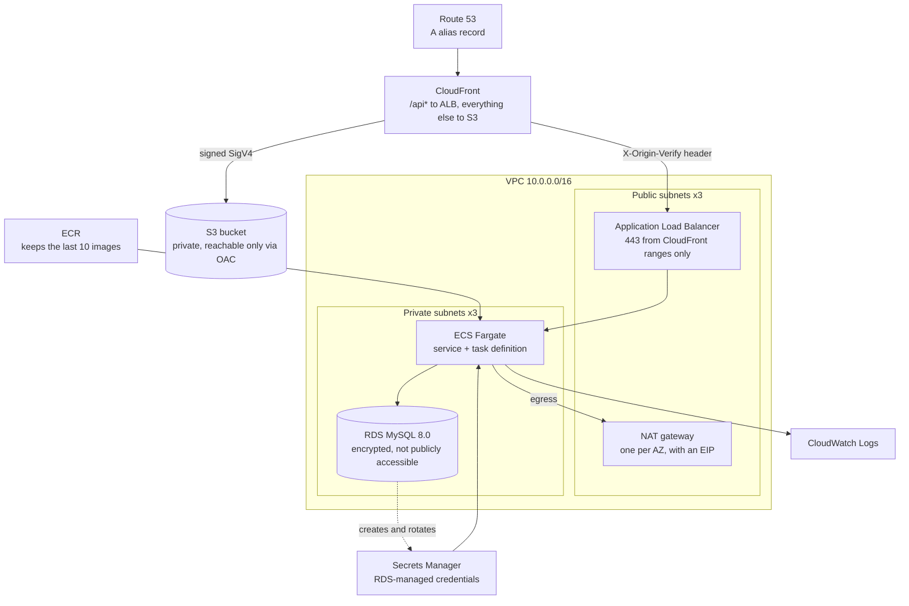

# Terraform ECS RDS template

AWS infrastructure for a containerised application: a private S3 frontend and
a Fargate API behind one CloudFront distribution, with a MySQL RDS instance in
private subnets.

One distribution serves both halves of the application. Static files come from
S3; anything under `/api*` is proxied to an Application Load Balancer in front
of the ECS service. The browser sees a single origin, so there is no CORS
configuration and no second certificate on the API path.

## Architecture



### Request path

A viewer resolves the domain to the distribution. Static paths are signed with
SigV4 and fetched from a bucket that allows no public access at all. `/api*`
is forwarded to the load balancer with a shared secret header; the listener
answers `403` to anything arriving without it, so the ALB cannot be used as a
way around CloudFront.

Unmatched paths return `/index.html` with a `200`, because the frontend is a
single-page app whose router resolves them in the browser. A REST origin has
no directory-index behaviour and reports a missing key as `403`, so both `403`
and `404` map to the shell.

Tasks run in private subnets with no public IP. They reach ECR, Secrets
Manager and CloudWatch outbound through the NAT gateways, and reach MySQL
through a security group that accepts traffic only from the tasks.

## What it creates

| Module | Resources |
| --- | --- |
| `vpc` | VPC, one public and one private subnet per AZ, route tables, internet gateway, one NAT gateway and EIP per private subnet |
| `security-groups` | ALB group (443 from the CloudFront managed prefix list), task group (container port from the ALB group), RDS group (3306 from a rule-less marker group attached to the tasks) |
| `alb` | Application Load Balancer, target group with health check, HTTP redirect listener, HTTPS listener defaulting to `403`, and a listener rule matching the origin header |
| `ecr` | Repository with a lifecycle policy keeping the last 10 images |
| `ecs` | Cluster, Fargate task definition and service, CloudWatch log group, separate execution and task roles |
| `rds` | MySQL instance with encrypted gp3 storage, subnet group, parameter group, optional enhanced-monitoring role |
| `s3` | Private bucket, public access block, ownership controls, encryption, Origin Access Control, CloudFront distribution, Route 53 alias record |

## Requirements

- Terraform >= 1.10
- AWS provider ~> 6.0, random ~> 3.6

These must exist before the first apply:

- A Route 53 public hosted zone for the frontend domain (`zone_id`)
- An ACM certificate in the stack's region for the ALB (`tsl_certificate_arn`)
- An ACM certificate **in `us-east-1`** for CloudFront
  (`tsl_certificatecloudfront`) — CloudFront accepts certificates from no
  other region
- Any application secrets in Secrets Manager (`secrets_arn`, `secrets_values`)
- An S3 bucket for Terraform state

The database credentials are **not** a prerequisite. RDS generates and rotates
the master password into a secret it owns, and the ARN is published as an
output and injected into the container as `DATABASE_SECRET_ARN`.

## Usage

The backend is a partial configuration, so state settings are supplied at init:

```bash
terraform init \
  -backend-config="bucket=your-terraform-state" \
  -backend-config="key=ecs-rds/prod.tfstate" \
  -backend-config="region=us-west-2"
```

```bash
terraform plan -var="name=demo" -var="environment=prod"
```

```bash
terraform apply -var="name=demo" -var="environment=prod"
```

To validate without touching the backend:

```bash
terraform init -backend=false && terraform validate
```

## Inputs

| Name | Description | Default |
| --- | --- | --- |
| `name` | Stack name, used as the prefix for every resource | _required_ |
| `environment` | Environment name, used as the suffix | `prod` |
| `region` | AWS region | `us-west-2` |
| `availability_zones` | AZs to spread subnets across | three in `us-west-2` |
| `cidr` | VPC CIDR block | `10.0.0.0/16` |
| `private_subnets` | One CIDR per AZ, must match the AZ count | three `/20`s |
| `public_subnets` | One CIDR per AZ, must match the AZ count | three `/20`s |
| `container_port` | Port the container listens on | `8080` |
| `container_cpu` | CPU units for the task | `512` |
| `container_memory` | Memory in MiB for the task | `2048` |
| `service_desired_count` | Tasks running in parallel | `1` |
| `health_check_path` | Path the target group polls | `/` |
| `tsl_certificate_arn` | ACM certificate for the ALB, in the stack's region | placeholder |
| `tsl_certificatecloudfront` | ACM certificate for CloudFront, in `us-east-1` | placeholder |
| `zone_id` | Route 53 hosted zone for the frontend domain | placeholder |
| `admin_front_domain` | Domain name that serves the admin frontend | placeholder |
| `admin_front_bucket` | Bucket name that stores the admin frontend | placeholder |
| `app_bucket` | Bucket the application reads and writes; empty grants no access | placeholder |
| `secrets_arn` | Secret ARNs the task is allowed to read | placeholder |
| `secrets_values` | Secrets injected as environment variables, as `{name, valueFrom}` | placeholder |

The `rds` module exposes further variables with safe defaults —
`instance_class`, `backup_retention_period`, `multi_az`, `deletion_protection`,
`monitoring_interval` and others. Set them on the module call to override.

## Outputs

| Name | Description |
| --- | --- |
| `aws_alb_target_group_arn` | Target group the service registers into |
| `aws_ecr_repository_url` | Repository to push images to |
| `ecs_cluster_name` | Cluster name, for deploy tooling |
| `executionRoleArn` | Role ECS uses to pull images and inject secrets |
| `taskRoleArn` | Role the application itself runs as |
| `cloudfront_s3-admin-front_domain` | Distribution domain name |

## Security posture

- The frontend bucket blocks all public access and has ACLs disabled. Only the
  distribution can read it, through an Origin Access Control with a bucket
  policy conditioned on the distribution ARN.
- The load balancer accepts 443 from the CloudFront origin-facing prefix list
  only, and forwards only requests carrying the shared `X-Origin-Verify`
  header. Port 80 is closed at the security group.
- The HTTPS listener uses `ELBSecurityPolicy-TLS13-1-2-2021-06`.
- Tasks accept traffic from the ALB security group, not from the internet.
- RDS storage is encrypted, backups run for 7 days, deletion protection is on,
  and the master password never passes through Terraform state.
- The execution role injects secrets at task start; the task role carries the
  application's own permissions. They are separate roles with separate policies.

## Operational notes

**The application must read its database credentials from Secrets Manager.**
The ARN arrives as `DATABASE_SECRET_ARN`, and the task role is allowed to read
it. `DATABASE_URL` and `DATABASE_NAME` are plain environment variables.

**Upload `index.html` with `Cache-Control: no-cache`.** Hashed assets should
get a long `max-age`, but a cached shell points at asset filenames the next
deploy has replaced. There is a `CachingDisabled` behaviour on `/index.html`,
which does not cover a request to `/`.

**A prefix list spends its max-entries count against the security group rule
quota.** The CloudFront list is large, which is why the ALB group has a single
ingress rule. Adding another rule that references it may need a quota increase.

**A deployment pipeline owns the running revision.** The service ignores
changes to `task_definition` and `desired_count`, so task definition edits here
take effect on the pipeline's next deploy, not on `terraform apply`.

**Certificates are regional.** CloudFront reads only from `us-east-1`; the ALB
reads only from the stack's own region. Two certificates, always.

## Known gaps

Not yet configured: CloudFront and ALB access logs, VPC flow logs, a WAF,
CloudWatch log group retention, ECR tag immutability and scan-on-push, VPC
endpoints for ECR and Secrets Manager, and service autoscaling. Three NAT
gateways run by default, one per AZ.
